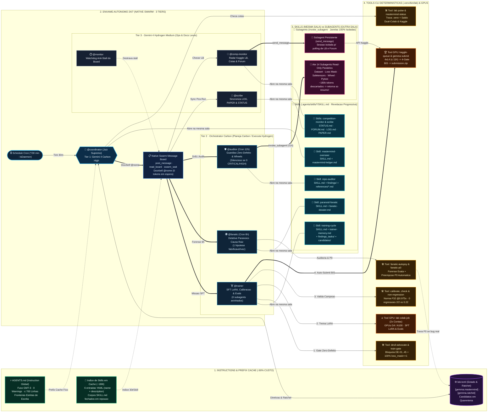
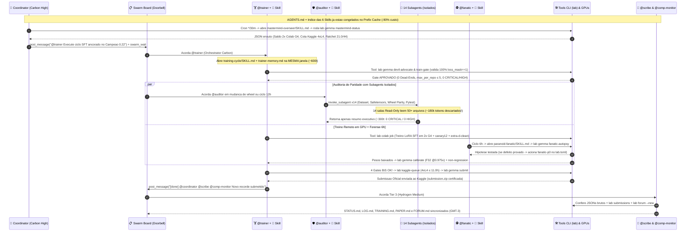

# Agentes na Medida — Pare de Fazer a IA Adivinhar

### 🚀 **[Abrir Apresentação no Navegador (GitHub Pages)](https://bigdecimals.github.io/agentes-na-medida/)**
Link direto: **`https://bigdecimals.github.io/agentes-na-medida/`**

---

Apresentação interativa (~15 minutos) em formato híbrido (**Scrollytelling + Slides**) sobre **Engenharia de Contexto** aplicada ao dia a dia:

1. **O Pedido Descritivo**: Como eliminar os "pontos cegos" onde a IA precisa adivinhar (Objetivo + Contexto + Restrições + Formato).
2. **Instructions & Prefix Caching**: Por que regras globais no topo do prompt ficam em cache (até 90% de economia em tokens e respostas mais rápidas).
3. **Instructions Modularizadas**: Carregamento sob medida por pasta/escopo (`/frontend`, `/backend`, `/tests`, `/docs`) para não poluir a janela de contexto.
4. **Tools (Ferramentas)**: Como poupar milhares de tokens tirando o trabalho braçal do prompt e reaproveitando scripts/integrações determinísticas.
5. **Skills vs. Subagents (Lado a Lado)**:
   - **Skills**: Manuais sob demanda carregados via *Revelação Progressiva* na **mesma conversa**.
   - **Subagents**: Especialistas com **janela de contexto isolada** para pesquisas pesadas sem poluir a conversa principal.
6. **Mapa de Decisão**: Guia prático de quando usar cada recurso.
7. **Estudo de Caso Real em Produção (Slide 10 — Enxame Autônomo 24/7)**: Arquitetura real do laboratório multiagente para o **Kaggle Gemma 4 Developer Agent**, demonstrando ao vivo (com zoom/pan interativo e tela cheia) como **Instructions em Cache (`AGENTS.md`)**, **Enxame em 3 Tiers de Modelos (`Swarm Board`)**, **6 Skills (`SKILL.md`)**, **14 Subagents Read-Only Isolados** e **Tools CLI Determinísticas (`lab`)** interagem sem poluir contexto nem colidir arquivos.

## Atalhos Durante a Apresentação

- `Scroll` ou setas `←` / `→` (`PageUp` / `PageDown`): Navegar entre os slides
- `1` a `9` e `0`: Ir direto para os Slides 01 a 10 (`0` abre o Slide 10 · Caso Real)
- `F`: Alternar **Tela Cheia**
- `N`: Abrir/fechar o **Roteiro do Apresentador** com tempo sugerido por seção
- No **Slide 10 (Caso Real)**: arraste para mover o diagrama, `Ctrl + Scroll` (ou botões `+`/`−`) para zoom, e duplo clique (ou `⛶ Ampliar Diagrama`) para tela cheia interativa (`Esc` para fechar)

---

## Estudo de Caso Real: Ecossistema Multiagente 24/7 (Mermaid)

### 1. Visão Completa — Agents, Skills, Subagents, Tools & Prefix Cache

### 2. Ciclo de Interação Passo a Passo (Sequence Diagram)

